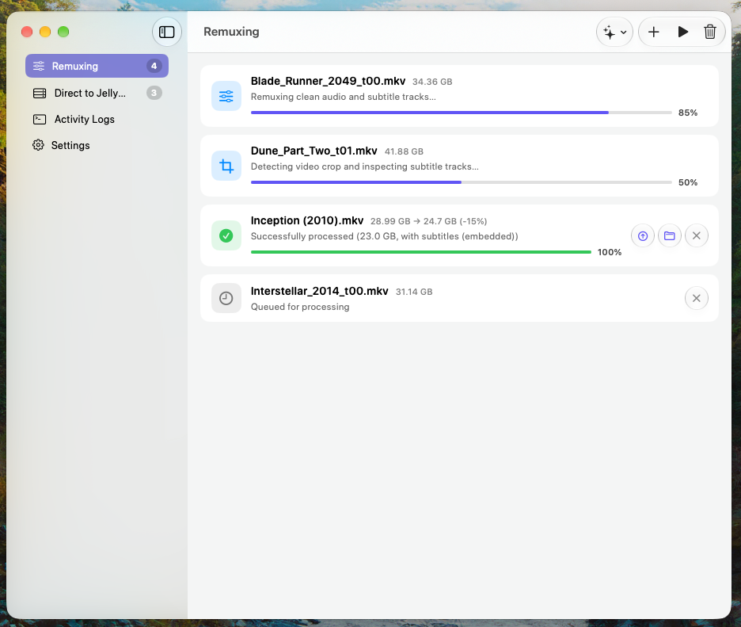
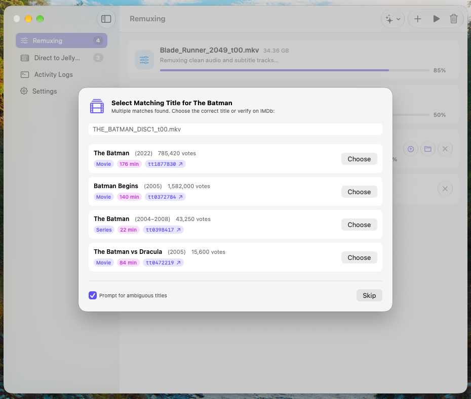
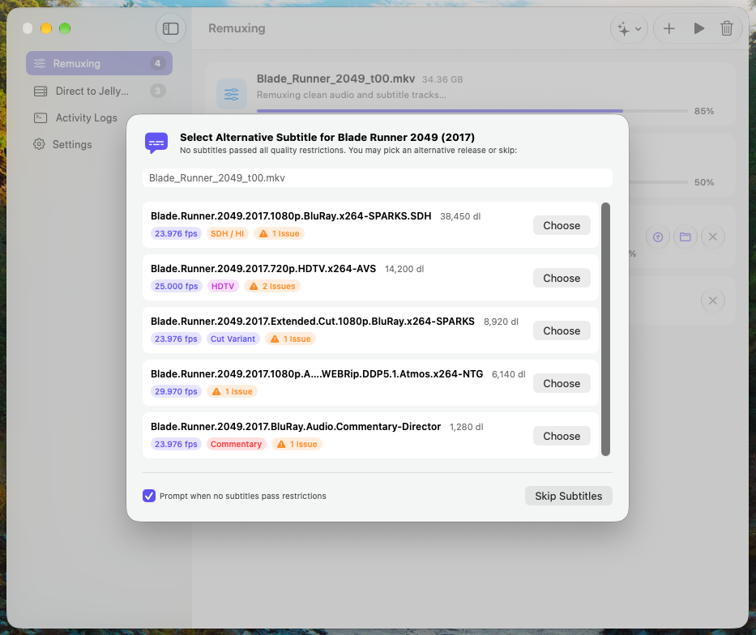
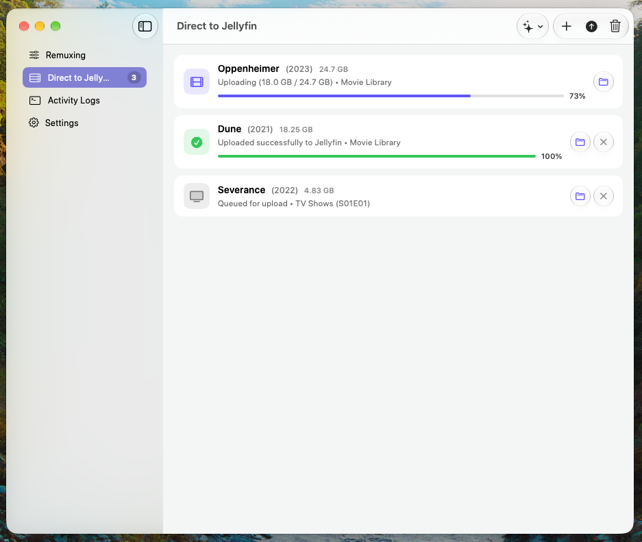
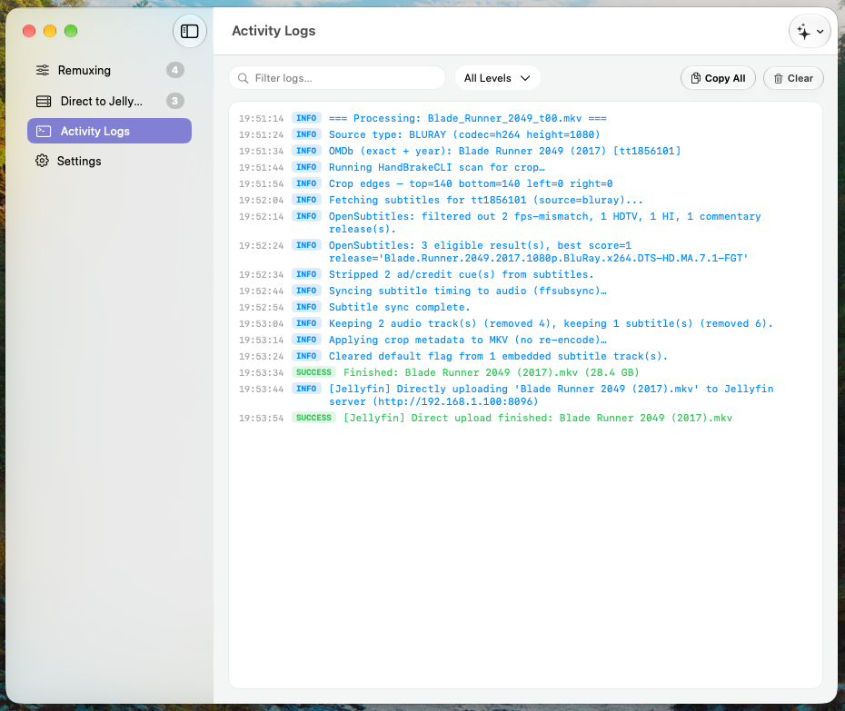

# JellyBoi Media Pipeline

An automated media processing pipeline and ingestion tool built for macOS and Jellyfin. JellyBoi Media Pipeline coordinates video inspection, aspect ratio and crop detection, online metadata resolution, subtitle fetching, container remuxing, and direct uploads into Jellyfin libraries.

The repository includes both a native macOS SwiftUI application and a headless command-line interface (`MediaPipelineCLI`) powered by a shared Swift engine framework (`RipPipelineEngine`).

---

## Visual Tour

### Automated Batch Remuxing

The remux queue accepts raw optical disc rips or unprocessed video files, automatically detecting source formats, inspecting audio and subtitle streams, stripping black bars, and remuxing them to clean Matroska containers.

<p align="center">
  
</p>

*Batch remux queue displaying multiple files across concurrent pipeline stages, live progress bars, and compression metrics.*

---

### Interactive Metadata & Subtitle Prompts

When disc titles are abbreviated or search queries return multiple possibilities, modal sheets allow on-the-fly disambiguation. Similar prompts trigger when subtitles require manual selection or alternative release evaluation.

<p align="center">
  
  &nbsp;&nbsp;
  
</p>

*Left: Title Disambiguation Sheet resolving ambiguous movie titles against IMDb. Right: Subtitle Fallback Picker displaying release tags, quality badges, FPS values, and exclusion flags.*

---

### Direct-to-Jellyfin Streaming & Activity Logging

Finished rips can be pushed directly to a Jellyfin server using the custom `Jellyfin.Plugin.JellyBoiUploadFile` plugin, completely bypassing manual file transfer steps. A dedicated log view provides visibility into underlying tool invocations.

<p align="center">
  
  &nbsp;&nbsp;
  
</p>

*Left: Direct to Jellyfin chunked streaming transfer queue. Right: Live logging console detailing tool invocations and stage progress.*

---

## Core Capabilities

- **Automatic Optical Disc Processing:** Handles DVD and Blu-ray source rips generated by tools like MakeMKV and HandBrake.
- **Intelligent Crop Detection:** Analyzes video streams using `ffmpeg cropdetect` to locate non-standard aspect ratios, removing letterboxing and pillarboxing while preserving native resolution and pixel aspect ratios.
- **Metadata Resolution via OMDb:** Parses disc naming patterns and automatically queries IMDb for official movie titles, release years, and runtime matching.
- **OpenSubtitles Integration:** Queries OpenSubtitles REST API v1 for synchronized subtitles. Automatically filters out hearing-impaired tags, commentary tracks, and frame-rate mismatched files unless selected.
- **Interactive Disambiguation UI:** When queries yield multiple close matches or no subtitle meets strict criteria, the application presents interactive selection sheets rather than failing or guessing incorrectly.
- **Direct-to-Jellyfin Server Upload:** Features chunked, resumable uploads directly to remote Jellyfin servers paired with the companion `Jellyfin.Plugin.JellyBoiUploadFile` server plugin.
- **Hardware-Accelerated Transcoding:** Integrates with Apple Silicon VideoToolbox (`videotoolbox_hevc`) for power-efficient encoding when remuxing requires video transcoding.
- **macOS Keychain Security:** Sensitive credentials such as OMDb API keys, OpenSubtitles credentials, and Jellyfin server tokens are stored securely in the system Keychain rather than plaintext configuration files.
- **Dual Architecture:** The core engine (`RipPipelineEngine`) is decoupled from presentation, powering both the SwiftUI desktop app and the standalone `MediaPipelineCLI` binary.

---

## Architecture Overview

```
                      +-----------------------------+
                      |   MKV Disc Rip / Raw File   |
                      +--------------+--------------+
                                     |
                                     v
                      +-----------------------------+
                      |     RipPipelineEngine       |
                      |  - MediaInspector           |
                      |  - CropDetector (ffmpeg)    |
                      |  - OMDbClient (IMDb)        |
                      |  - OpenSubtitlesClient      |
                      |  - TrackRemuxer (mkvmerge)  |
                      +--------------+--------------+
                                     |
                 +-------------------+-------------------+
                 |                                       |
                 v                                       v
+---------------------------------+     +---------------------------------+
|     JellyBoiMediaPipeline       |     |        MediaPipelineCLI         |
|   (macOS SwiftUI Application)   |     |    (Headless CLI Executable)    |
|   - Real-time queue view        |     |   - Terminal progress output    |
|   - Disambiguation modals       |     |   - Interactive terminal prompt |
|   - Keychain storage helper     |     |   - Automation / cron friendly  |
+----------------+----------------+     +----------------+----------------+
                 |                                       |
                 +-------------------+-------------------+
                                     |
                                     v
                      +-----------------------------+
                      |  Organized Media Directory  |
                      +--------------+--------------+
                                     |
                                     v
                      +-----------------------------+
                      | Direct to Jellyfin Upload   |
                      | (JellyBoi Upload Plugin)    |
                      +--------------+--------------+
                                     |
                                     v
                      +-----------------------------+
                      |     Jellyfin Media Server   |
                      +-----------------------------+
```

---

## Component Stack

| Layer | Technology | Details |
| :--- | :--- | :--- |
| **User Interface** | SwiftUI & AppKit | macOS native application with custom themes, sidebar navigation, and modals |
| **Engine Core** | Swift 6 (`RipPipelineEngine`) | Asynchronous, concurrent pipeline architecture (`Sendable`, structured concurrency) |
| **CLI Target** | `MediaPipelineCLI` | Headless command-line utility for script integration and automations |
| **Media Tools** | `ffmpeg`, `ffprobe`, `mkvmerge`, `HandBrakeCLI` | Underlying binaries dynamically detected and validated via `ToolRegistry` |
| **Metadata & Subtitles** | OMDb API, OpenSubtitles.com REST API | Remote data fetching, heuristic scoring, and subtitle cleaning |
| **Server Target** | Jellyfin Media Server | Custom chunked HTTP file receiver plugin |
| **Security** | Apple Security Framework (`KeychainHelper`) | Secure on-device credential storage |

---

## External Tool Prerequisites

The engine checks for the availability of external CLI utilities at runtime:

| Tool | Purpose | Installation (Homebrew) |
| :--- | :--- | :--- |
| `mkvmerge` | Container remuxing, stream selection, subtitle track insertion | `brew install mkvtoolnix` |
| `ffmpeg` | Crop detection, video filtering, and audio conversion | `brew install ffmpeg` |
| `ffprobe` | Stream format and track metadata inspection | Bundled with `ffmpeg` |
| `HandBrakeCLI` | Transcoding and source encoding fallback | `brew install handbrake` |
| `makemkvcon` | Optical disc extraction (optional, for direct disc workflows) | MakeMKV macOS package |

---

## Building and Running

### Requirements

- macOS 14.0 or newer
- Xcode 16.0 or newer
- Swift 6.0

### Xcode Build

1. Open `JellyBoiMediaPipeline.xcodeproj` in Xcode.
2. Select either the `JellyBoiMediaPipeline` scheme (macOS application) or the `MediaPipelineCLI` scheme (command-line executable).
3. Build and run using `Product -> Run` (`Cmd + R`).

### Command Line Build

To compile via `xcodebuild`:

```bash
xcodebuild -project JellyBoiMediaPipeline.xcodeproj \
           -scheme JellyBoiMediaPipeline \
           -configuration Release \
           build
```

---

## The JellyBoi Ecosystem

JellyBoi Media Pipeline is part of a multi-project suite designed for personal media streaming:

- **[JellyBoi](https://github.com/GarrettButchko/jellyboi):** Native client application for iOS and macOS providing hardware-accelerated playback from Jellyfin servers.
- **[JellyBoi Upload File Plugin](https://github.com/GarrettButchko/jellyfin_plugin_jellyboiFileUpload):** A Jellyfin server plugin enabling resumable, high-throughput file uploads directly to server library directories.
- **JellyBoi Media Pipeline:** Automated disc ripping, subtitle management, metadata enrichment, and media organization suite.

---

## License

This project is licensed under the terms defined in the repository license. External command-line tools invoked by this pipeline (`ffmpeg`, `mkvtoolnix`, `HandBrakeCLI`) remain subject to their respective open-source licenses.
